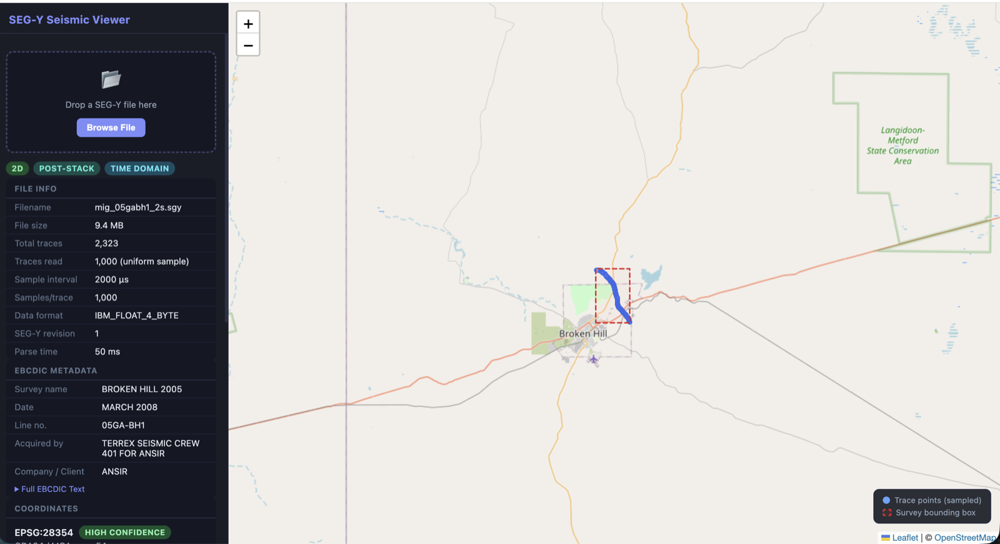
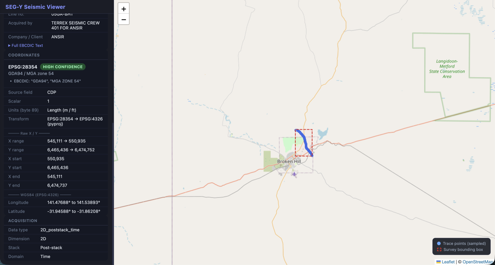

# SEG-Y Viewer

A lightweight web tool that reads a SEG-Y seismic file, classifies the data, works out which coordinate reference system (CRS) the trace coordinates are in, and plots the survey on a map. All of this runs from the headers, without loading the trace data.

Built for **Australian and Papua New Guinea** datasets.


*File info, data-type classification and EBCDIC metadata for Geoscience Australia line 05GA-BH1.*


*Detected source CRS with confidence and evidence, native X/Y, and the WGS84 extent plotted on the map.*

## Why

SEG-Y files almost never state an EPSG code. The CRS is usually buried in free-text EBCDIC header lines such as `NOTE: X & Y ARE REAL COORDINATES. GDA94, MGA ZONE 54`, or it isn't there at all. If you pick the wrong CRS, or approximate the projection maths, a survey can land kilometres from where it really is. This tool makes the CRS decision explicit: it reports the EPSG it chose, how confident it is, the evidence for the choice, and the other candidates.

## Features

- **Header parsing**: EBCDIC text header, binary header, and trace headers (sampled to 1,000 traces, so a 38 MB file parses in about 60 ms)
- **Data classification**:
  - 2D vs 3D (inline/crossline grid fill ratio, then PCA linearity of source positions)
  - pre-stack vs post-stack
  - time vs depth domain
  - marine vs land
- **Metadata extraction** from the EBCDIC header: survey, line, company, contractor, date. Uses regex by default, or Claude if an API key is set.
- **CRS detection**: picks a source EPSG code with a confidence level, the evidence for it, and alternative candidates. A manual EPSG override is available.
- **Rigorous transformation** to WGS84 with [pyproj](https://pyproj4.github.io/pyproj/). No hand-rolled UTM approximations.
- **Map view** (Leaflet + OpenStreetMap) showing trace positions and the survey bounding box

## CRS detection

Evidence is applied in priority order:

1. User-supplied EPSG code
2. Trace header byte 89 (`CoordinateUnits`): arc-seconds, decimal degrees or DMS mean the coordinates are geographic
3. An explicit `EPSG:xxxx` in the EBCDIC header
4. Datum, projection and zone in the EBCDIC header, e.g. `GDA94, MGA ZONE 54`, `AGD66 AMG 55`, `PNGMG94 ZONE 54`
5. Acquisition year, which rules out impossible datums (2005 data cannot be GDA2020)
6. Region (Australia or PNG), chosen by the user or inferred from position, to fill in a missing datum

Each candidate is then checked against its EPSG **area of use**. If the transformed coordinates fall outside it, the next candidate that fits is used and the confidence is lowered.

Supported CRS families:

| Family | EPSG | Zones |
|---|---|---|
| GDA2020 / MGA | 78zz | 46–59 |
| GDA94 / MGA | 283zz | 48–58 |
| AGD84 / AMG | 203zz | 48–58 |
| AGD66 / AMG | 202zz | 48–58 (54–56 also cover PNG) |
| PNG94 / PNGMG94 | 5550, 5551, 5552, 9874 | 54–57 |
| WGS 84 / UTM south | 327zz | 46–59 |
| Geographic | 7844, 4283, 4203, 4202, 5546, 4326 | – |

**Example:** Geoscience Australia line 05GA-BH1 (L174 Broken Hill) is detected as **EPSG:28354, high confidence**, from the header line `GDA94, MGA ZONE 54`. The tool's first version used a linear UTM approximation, which placed the line about **2.2 km** from its true position.

## Architecture

```
Browser (static/)                      server.py (stdlib ThreadingHTTPServer)
  upload, EPSG override  ── POST ──▶   stream body to temp file
  CRS card, map          ◀── JSON ──   _parse_and_classify()
                                          ├─ segy_parser.py   headers via segyio
                                          ├─ classifier.py    data type + EBCDIC metadata
                                          ├─ coord_utils.py   scalars, units, GeoJSON
                                          └─ crs_detect.py    EPSG inference + pyproj transform
```

- The pipeline modules are plain functions with no web dependencies, so they can be reused in batch jobs or other pipelines.
- The response keeps the **native coordinates and source EPSG** alongside the WGS84 geometry, ready for downstream systems.
- The server keeps no state: uploads are streamed to a temp file, parsed and deleted.

## Quick start

Requires Python 3.10+.

```bash
pip install -r requirements.txt
python server.py
# open http://localhost:8000
```

Drag one of the bundled samples into the page to try it:

| Sample | What it shows |
|---|---|
| [`samples/broken_hill_gda94_mga54.sgy`](samples/broken_hill_gda94_mga54.sgy) | Header states `GDA94, MGA ZONE 54` → **EPSG:28354, high confidence** |
| [`samples/png_gulf_utm55_no_datum.sgy`](samples/png_gulf_utm55_no_datum.sgy) | Header only says `UTM ZONE 55` → region inferred as PNG, **AGD66 / AMG 55 (EPSG:20255), medium confidence**, with WGS84 UTM 55S and PNGMG94 as alternatives. The line was generated in WGS84 UTM 55S, so the default lands ~120 m off. Click the EPSG:32755 alternative to see the line move into place. |

The samples are small synthetic files (≈370 KB each, labelled `SYNTHETIC` in their EBCDIC header). Regenerate them with `python samples/make_samples.py`.

The server listens on `127.0.0.1` only. Set `SEGY_VIEWER_HOST` / `SEGY_VIEWER_PORT` to change this.

Optional: `export ANTHROPIC_API_KEY=...` (and `pip install anthropic`) to extract EBCDIC metadata with Claude Haiku instead of regex. When enabled, the EBCDIC header text is sent to the Anthropic API. CRS detection is always rule-based.

### API

```
POST /api/upload?filename=line.sgy&region=auto|australia|png|geographic&epsg=28354
Content-Type: application/octet-stream
<raw SEG-Y bytes>
```

## Tests

```bash
pip install pytest
python -m pytest
```

The test suite generates small synthetic SEG-Y files with segyio, so no external data is needed. It covers:
- CRS detection across Australian and PNG scenarios
- coordinate conversions
- the end-to-end pipeline
- the HTTP layer, including path traversal protection

## Limitations

- Only reads headers: no amplitude or section display
- Detection cannot tell when the EBCDIC header names the *wrong* UTM zone, because any zone's coordinates fall inside that zone's own area of use
- The GDA94/GDA2020 → WGS84 step uses PROJ's default (ballpark) transformation, which is fine for display but accurate to about a metre, not millimetres
- Coverage is limited to Australia and PNG

## Real data

The screenshots and the ~2.2 km example use a real public dataset that is not included in this repository (≈95 MB):

**L174 Broken Hill 2D Seismic Survey, NSW, 2005: stacked and migrated seismic data and images for lines 05GA-BH1 and 05GA-BH1EXP**
- Catalogue record: [pid.geoscience.gov.au/dataset/ga/74856](https://pid.geoscience.gov.au/dataset/ga/74856)
- Download: [L174_Processed_Seismic_Package.zip](https://d28rz98at9flks.cloudfront.net/74856/L174_Processed_Seismic_Package.zip)

© Commonwealth of Australia (Geoscience Australia). Licensed under [CC BY 4.0](https://creativecommons.org/licenses/by/4.0/).

After unzipping, drag any `.sgy` from `L174_Processed_Data/` into the viewer.

## Licence

[MIT](LICENSE)
